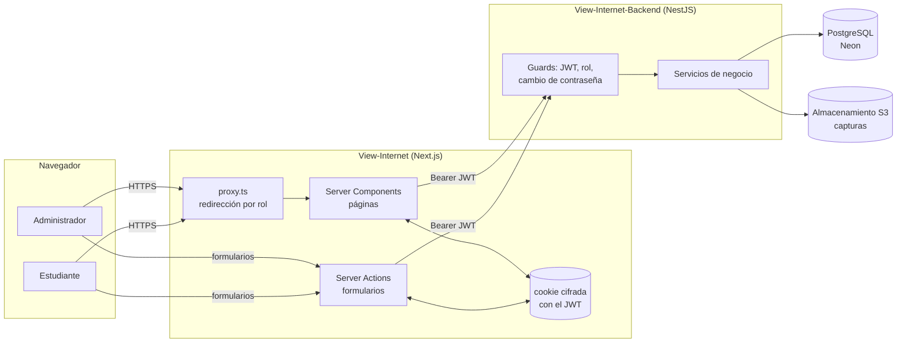

# Documentación de View Internet (web)

View Internet controla el pago mensual del internet de la sede de Informática. El sistema tiene dos partes:

| Repositorio                                                                                         | Qué hace                                                                                                    |
| --------------------------------------------------------------------------------------------------- | ----------------------------------------------------------------------------------------------------------- |
| **View-Internet** (este)                                                                            | App web en Next.js. Muestra datos y envía acciones; no decide reglas de negocio.                            |
| [View-Internet-Backend](https://github.com/Centro-De-Estudiantes-Informatica/View-Internet-Backend) | API REST en NestJS. Guarda los datos y aplica todas las reglas: estados, conversiones de moneda y permisos. |

## Cómo encaja todo

El navegador **nunca habla con la API**. Toda llamada sale del servidor de Next.js con el token de la sesión, guardado en una cookie que JavaScript no puede leer (patrón _Backend for Frontend_).

## Roles

|                                               | Administrador    | Estudiante   |
| --------------------------------------------- | ---------------- | ------------ |
| Inicio                                        | `/admin` (panel) | `/mi-cuenta` |
| Ver ingresos y métricas                       | ✓                |              |
| Buscar personas, cambiar roles, crear cuentas | ✓                |              |
| Registrar pagos en efectivo                   | ✓                |              |
| Aprobar, rechazar o anular pagos              | ✓                |              |
| Configurar cuota y tasas                      | ✓                |              |
| Ver su estado y su historial                  |                  | ✓            |
| Reportar un pago móvil                        |                  | ✓            |

## Documentos

| Documento                       | Para qué sirve                                                              |
| ------------------------------- | --------------------------------------------------------------------------- |
| [Arquitectura](arquitectura.md) | Capas de la app, sesión, comunicación con la API, caché y manejo de errores |
| [Flujos](flujos.md)             | Paso a paso de cada proceso: ingreso, pagos, revisión, roles                |
| [Pantallas](pantallas.md)       | Qué muestra cada ruta y de dónde salen sus datos                            |
| [Desarrollo](desarrollo.md)     | Instalación, variables, API simulada, pruebas, convenciones y despliegue    |

Las reglas de negocio (cómo se calcula si alguien está al día, cómo se convierten las monedas, qué puede hacer cada rol) están documentadas en el backend: [reglas de negocio](https://github.com/Centro-De-Estudiantes-Informatica/View-Internet-Backend/blob/main/docs/reglas-de-negocio.md).
