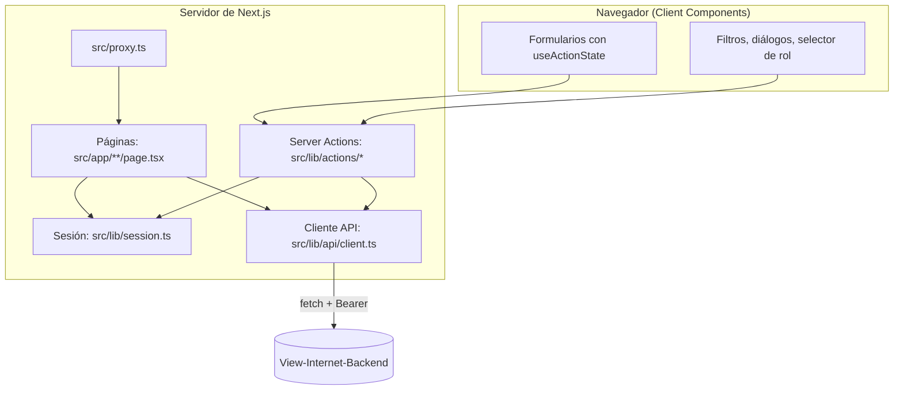

# Arquitectura de la web

## Stack

| Pieza                                      | Uso                                                                                                  |
| ------------------------------------------ | ---------------------------------------------------------------------------------------------------- |
| Next.js 16 (App Router)                    | Páginas, Server Components, Server Actions, Proxy                                                    |
| Cache Components (`cacheComponents: true`) | Prerender parcial: el esqueleto de cada página es estático y los datos llegan dentro de `<Suspense>` |
| TypeScript estricto                        | Todo el código                                                                                       |
| Tailwind CSS 4 + shadcn/ui (Base UI)       | Estilos y componentes accesibles (diálogos, menús)                                                   |
| iron-session                               | Cifrado de la cookie de sesión                                                                       |
| openapi-fetch + openapi-typescript         | Cliente de la API tipado desde el OpenAPI del backend                                                |
| zod                                        | Validación de variables de entorno y formularios                                                     |
| MSW                                        | API simulada para desarrollo y pruebas                                                               |
| Vitest, Playwright, axe                    | Pruebas unitarias, e2e y de accesibilidad                                                            |

## Capas



| Carpeta              | Contenido                                                                       |
| -------------------- | ------------------------------------------------------------------------------- |
| `src/app/(auth)/`    | Login y cambio de contraseña (sin menú)                                         |
| `src/app/admin/`     | Panel, Personas, Pagos y Ajustes, con su layout (menú lateral o barra inferior) |
| `src/app/mi-cuenta/` | Portal del estudiante                                                           |
| `src/app/salir/`     | Route Handler que borra la cookie y vuelve al login                             |
| `src/app/api/mock/`  | API simulada (solo con `API_MOCKING=enabled`)                                   |
| `src/components/`    | Componentes de la app; `ui/` son los de shadcn                                  |
| `src/lib/api/`       | Cliente, tipos generados (`schema.d.ts`) y alias de tipos (`types.ts`)          |
| `src/lib/actions/`   | Server Actions agrupadas por dominio                                            |
| `src/lib/`           | Sesión, formato de dinero y fechas, bancos, mensajes de error                   |
| `src/mocks/`         | Handlers de la API simulada                                                     |
| `e2e/`               | Pruebas Playwright                                                              |

## Sesión

1. El login es una Server Action (`login` en `src/lib/actions/auth.ts`) que llama a `POST /auth/login`.
2. La respuesta trae el JWT, su duración, el rol y `mustChangePassword`. Todo eso se cifra con `SESSION_SECRET` y se guarda en la cookie `vi_session`:
   - `httpOnly`: JavaScript del navegador no la puede leer.
   - `secure` en producción, `sameSite=lax`, y vence junto con el JWT (8 h por defecto).
3. En cada petición, el servidor descifra la cookie (`getSession()`) y usa el token como `Authorization: Bearer` contra la API.

```ts
// src/lib/session-core.ts
interface Session {
  token: string
  userId: string
  role: "ADMIN" | "ESTUDIANTE"
  fullName: string
  cedula: string
  mustChangePassword: boolean
  expiresAt: number // vencimiento del JWT, en ms
}
```

### Tres niveles de control de acceso

| Nivel              | Dónde                                | Qué hace                                                                                                                            |
| ------------------ | ------------------------------------ | ----------------------------------------------------------------------------------------------------------------------------------- |
| 1. Proxy           | `src/proxy.ts`                       | Chequeo rápido con la cookie: sin sesión → `/login`; contraseña temporal → `/cambiar-clave`; estudiante en `/admin` → `/mi-cuenta`. |
| 2. Página / acción | `requireAdmin()`, `requireSession()` | Cada página y cada Server Action vuelve a exigir la sesión y el rol.                                                                |
| 3. API             | Guards del backend                   | La autorización real. El backend toma el rol de la base de datos, no del token, así que quitar un rol tiene efecto de inmediato.    |

El proxy y la página son defensas de UX; **la única que protege los datos es la API**.

### Sesión vencida o invalidada

Si la API responde **401** (token vencido, contraseña restablecida, etc.), `call()` redirige a `/salir?motivo=expirada`. Esa Route Handler borra la cookie y lleva al login con el aviso "Tu sesión expiró". Hace falta esa ruta porque un Server Component no puede borrar cookies.

| Respuesta de la API            | Qué hace la web                               |
| ------------------------------ | --------------------------------------------- |
| 401                            | `/salir?motivo=expirada` → login              |
| 403 `PASSWORD_CHANGE_REQUIRED` | `/cambiar-clave`                              |
| 403 `ACCOUNT_DISABLED`         | `/salir?motivo=desactivada` → login con aviso |

## Comunicación con la API

`src/lib/api/client.ts` expone:

- `api()`: cliente con el token de la sesión actual (sin sesión, redirige al login).
- `publicApi()`: cliente sin token, solo para el login.
- `call(promesa)`: espera la llamada y devuelve los datos, o lanza `ApiError` con el código de negocio. Si la API no responde, lanza `ApiError(503, "SERVICE_UNAVAILABLE")` y registra la causa en el log del servidor.

```ts
const client = await api()
const summary = await call(client.GET("/metrics/summary", { params: { query: { periodo } } }))
```

Las rutas, parámetros y respuestas están tipados desde el OpenAPI del backend: si la API cambia, `npm run api:types` regenera los tipos y TypeScript señala lo que hay que ajustar.

### Convenciones del contrato

- **Montos**: llegan y se envían como **strings decimales** (`"1000.00"`), nunca como `number`, para no perder precisión. La web solo los formatea (`formatMoney`) y convierte lo que escribe el usuario (`parseAmountInput`).
- **Fechas**: `AAAA-MM-DD`; periodos: `AAAA-MM`. "Hoy" se calcula en hora de Venezuela (`todayIso()`).
- **Bancos**: código SUDEBAN de 4 dígitos (`0134`); `src/lib/banks.ts` traduce código ↔ nombre.
- **Errores**: `{ code, message }`. `src/lib/errors.ts` traduce cada `code` a un mensaje en español.
- **IP del usuario**: el login reenvía `X-Forwarded-For` para que el límite de intentos por IP del backend cuente la IP del navegador y no la del servidor de la web.

## Lectura de datos y caché

Next 16 trae **Cache Components**. Con eso, leer cookies, `searchParams` o la hora actual solo se puede hacer dentro de un `<Suspense>`. Por eso todas las páginas siguen el mismo patrón:

```tsx
export default function Page(props: PageProps<"/admin/personas">) {
  return (
    <>
      <PageHeader title="Personas" /> {/* estático: va en el prerender */}
      <Suspense fallback={<ListSkeleton />}>
        <PeopleList searchParams={props.searchParams} /> {/* sesión + API: en cada petición */}
      </Suspense>
    </>
  )
}
```

- Las llamadas a la API usan `cache: "no-store"`: los pagos cambian todo el tiempo y no se cachean.
- `getSession()` llama a `connection()` porque valida la sesión contra la hora actual.
- Los menús usan `usePathname()` dentro de `<Suspense>`; mientras tanto se muestra una versión estática sin ítem activo.

## Escritura: Server Actions

Cada formulario usa `useActionState` con una Server Action de `src/lib/actions/`. Todas siguen el mismo patrón:

1. `requireAdmin()` o `requireSession()`: nunca confiar en el cliente.
2. Validar los campos; si fallan, devolver `{ ok: false, fields }` con el error de cada campo.
3. Llamar a la API con `call()`.
4. Si funciona, llamar a `refresh()` para que la vista muestre los datos nuevos y devolver `{ ok: true, message }`.
5. Si falla, `toFailure()` traduce el `ApiError` a un mensaje y, cuando aplica, lo asigna al campo correcto (por ejemplo, `DUPLICATE_REFERENCE` → campo "referencia").

React 19 vacía los formularios después de cada acción. Para no perder lo escrito cuando hay un error, `keepValues()` devuelve los valores enviados y el formulario los usa como `defaultValue`.

```ts
type ActionResult<T> =
  | { ok: true; data: T; message?: string }
  | {
      ok: false
      code: string
      message: string
      fields?: Record<string, string>
      values?: Record<string, string>
    }
  | null
```

## Tema visual

- Los colores son variables CSS en `src/app/globals.css` (modo claro en `:root`, oscuro en `[data-theme="dark"]`) mapeadas a clases de Tailwind (`bg-card`, `text-ok`, `bg-partial-soft`…).
- `next-themes` pone `data-theme` en `<html>`: sigue al sistema hasta que el usuario elige con el botón de tema.
- El fondo es una malla de puntos (nodos de red) en `body`; el login suma líneas entre nodos y ondas Wi-Fi (`NetBackground`).
- Tipografía: Sora (títulos), IBM Plex Sans (texto) y JetBrains Mono para cédulas, montos y referencias (utilidad `tabular`).
- Los estados siempre llevan texto (y en el portal también un ícono), nunca solo color. Los colores se verifican con axe en ambos modos.
