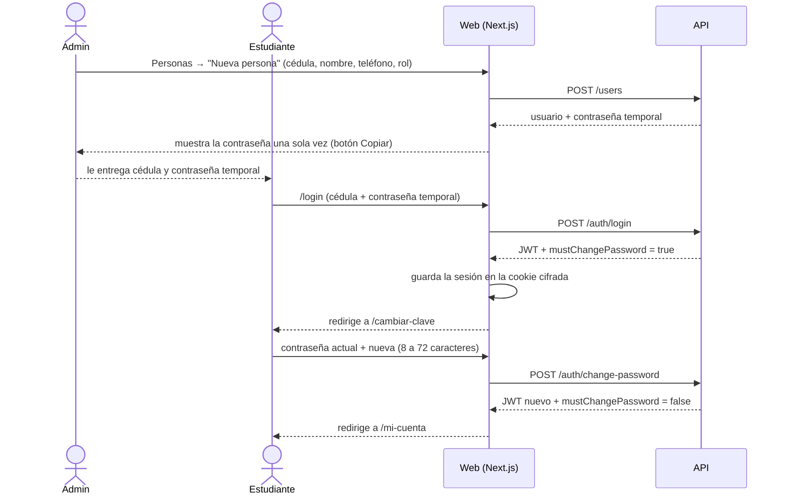
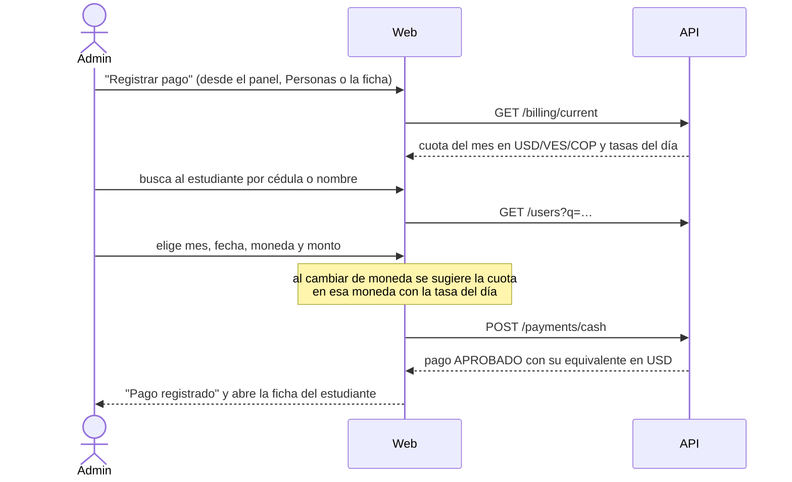
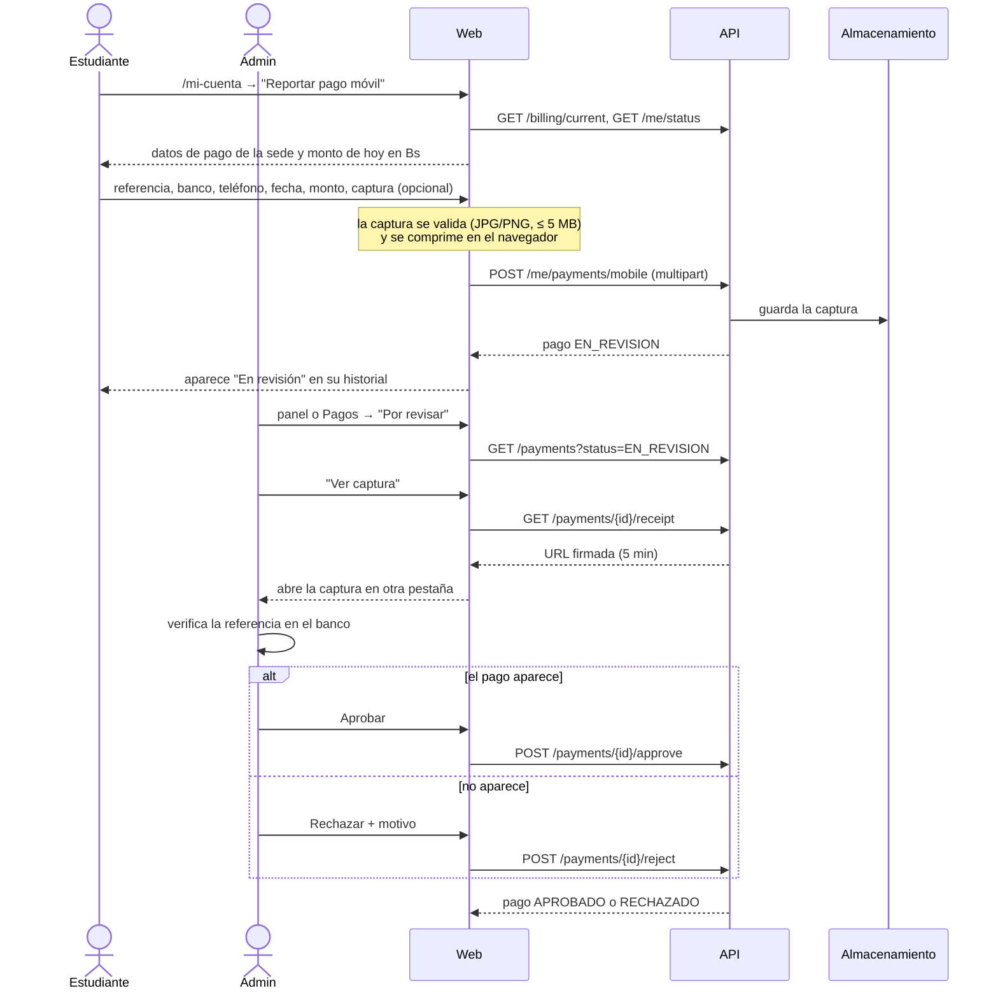
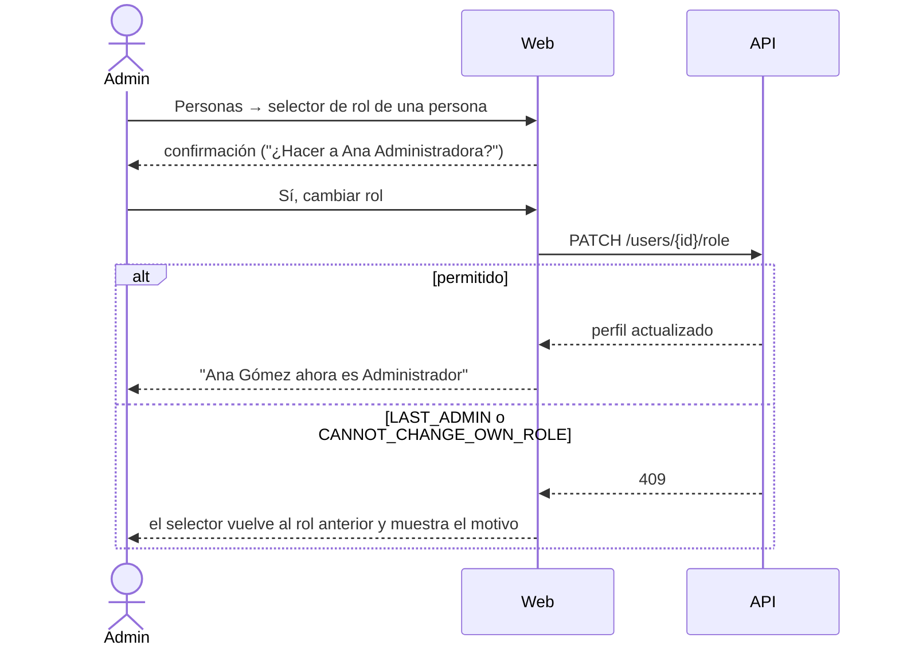

# Flujos del sistema

Cada flujo indica qué hace la persona, qué pasa en la web y qué endpoint de la API se usa. Las reglas que aplica la API están en las [reglas de negocio del backend](https://github.com/Centro-De-Estudiantes-Informatica/View-Internet-Backend/blob/main/docs/reglas-de-negocio.md).

## 1. Alta de una persona y primer ingreso

Las cuentas las crea un administrador; no hay autorregistro.

- La cédula se acepta en cualquier formato: `V-28.123.456`, `28123456` o `v28123456`.
- Si la cédula ya existe, el formulario muestra "Esta cédula ya está registrada" con un enlace para buscarla.
- Mientras la contraseña sea temporal, la API rechaza todo con `PASSWORD_CHANGE_REQUIRED` y la web lleva a `/cambiar-clave`.
- Tras 5 intentos fallidos en 15 minutos para la misma cédula, la API responde 429 y la web pide esperar.

## 2. Registrar un pago en efectivo

Lo hace el administrador cuando recibe dinero en la sede, en dólares, bolívares o pesos.

- El pago queda **aprobado** al guardarse y cuenta de inmediato en el estado del estudiante y en las métricas.
- La API congela la tasa del día del pago: si mañana sube el dólar, el pago sigue valiendo lo mismo en USD.
- Si falta la tasa de esa moneda, la API responde `RATE_MISSING` y la web ofrece ir a cargarla.
- Se puede pagar un mes futuro (hasta 12 meses por adelantado) o uno anterior.

## 3. Pago móvil: reporte y revisión

El pago móvil solo es en bolívares. Lo reporta el estudiante y lo confirma un administrador.

- El reporte se asigna al **mes adeudado más antiguo**; si no debe nada, al mes actual.
- La misma referencia en el mismo banco no puede reportarse dos veces mientras esté en revisión o aprobada (`DUPLICATE_REFERENCE`).
- El motivo del rechazo es obligatorio y el estudiante lo ve en su historial.
- Si dos administradores revisan el mismo pago a la vez, el segundo recibe `INVALID_PAYMENT_STATE` y la web avisa que ya fue revisado.

## 4. Anular un pago

Los pagos **nunca se borran**. Si un pago aprobado se registró por error, se anula:

1. Personas → ficha del estudiante, o Pagos → "Anular".
2. La web exige un motivo y confirmación → `POST /payments/{id}/void`.
3. El pago queda `ANULADO`, tachado en el historial, y deja de contar en el estado y las métricas.

## 5. Cambiar el rol de una persona

- El selector de la propia cuenta está deshabilitado: nadie puede quitarse su rol.
- Siempre debe quedar al menos un administrador activo.
- El cambio tiene efecto de inmediato: la API toma el rol de la base de datos en cada petición, no del token.

## 6. Restablecer contraseña y desactivar cuentas

Desde la ficha de una persona (`/admin/personas/{id}`):

- **Restablecer contraseña** → `POST /users/{id}/reset-password`: muestra una contraseña temporal nueva y cierra las sesiones abiertas de esa persona.
- **Desactivar cuenta** → `PATCH /users/{id}` con `active: false`: la persona no puede entrar y deja de contarse en lo esperado de los meses siguientes. Su historial se conserva. No se puede desactivar la propia cuenta ni al último administrador.

## 7. Cuota mensual y tasas del día

En `/admin/ajustes`:

- **Cuota** → `PUT /billing/fee`. Si el mes en curso ya está abierto, conserva su cuota y la nueva aplica desde el mes siguiente; la web lo avisa.
- **Tasa del día** (Bs/USD o COP/USD) → `POST /billing/rates`. Se escribe con coma decimal (`200,50`). Registrar otra tasa para el mismo día la corrige.
- El panel avisa en ámbar cuando la última tasa tiene más de un día.

## 8. Lo que ve el estudiante

`/mi-cuenta` muestra, con datos de `GET /me/status` y `GET /me/payments`:

- **Al día**: el mes está pagado; indica hasta qué fecha está cubierto.
- **En revisión**: todo lo que debe está reportado y espera aprobación.
- **Pendiente / Parcial**: lista los meses que debe y el total pendiente en $, Bs y COP, con el botón para reportar el pago móvil. Si paga en efectivo, se lo entrega al administrador.
- El historial muestra todos sus pagos, con el motivo si alguno fue rechazado o anulado.
